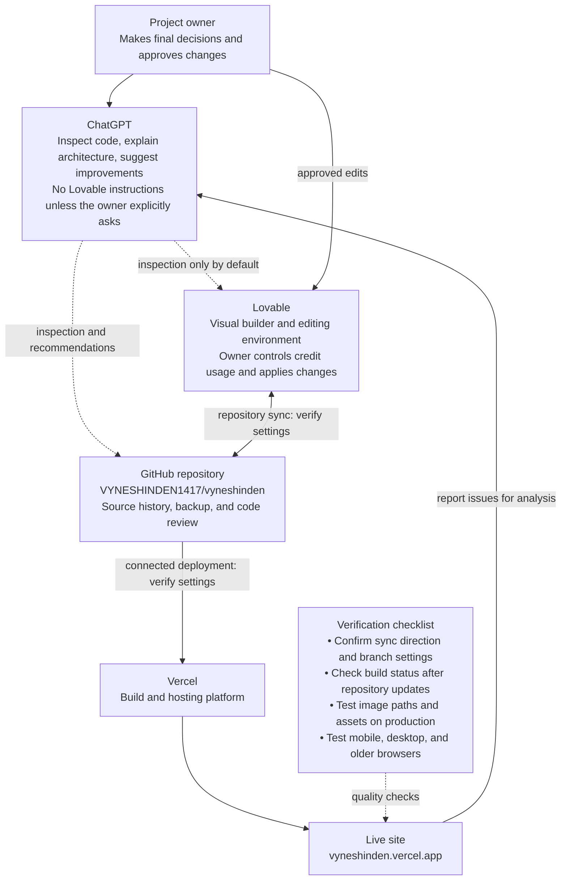

# Vyneshinden Project Workflow

This document describes the current intended workflow across ChatGPT, Lovable, GitHub, and Vercel. Treat arrows marked **verify** as assumptions until checked in the relevant project settings.

## Workflow diagram

## Roles and operating rules

- **Project owner:** You decide what changes are worth making and whether they should be passed to Lovable.
- **ChatGPT:** Inspect the repository and deployments, explain findings, propose improvements, and help verify results. Do not send instructions to Lovable unless you explicitly authorize that for a specific task.
- **Lovable:** The visual builder. You control when to spend credits and apply edits.
- **GitHub:** Repository backup and version history. Review changes and commits to understand what actually changed.
- **Vercel:** Deployment and hosting. A Git integration commonly triggers deployments from configured branches, but the exact branch, build settings, and sync direction must be checked in this project's settings.

## Known checks

- The live site is `https://vyneshinden.vercel.app/`.
- Broken images have previously been observed on the Vercel deployment. Verify asset paths, filename casing, and whether assets are included in the build output.
- This diagram documents the intended workflow; it does not prove that every connection or automatic sync is configured exactly as drawn.
